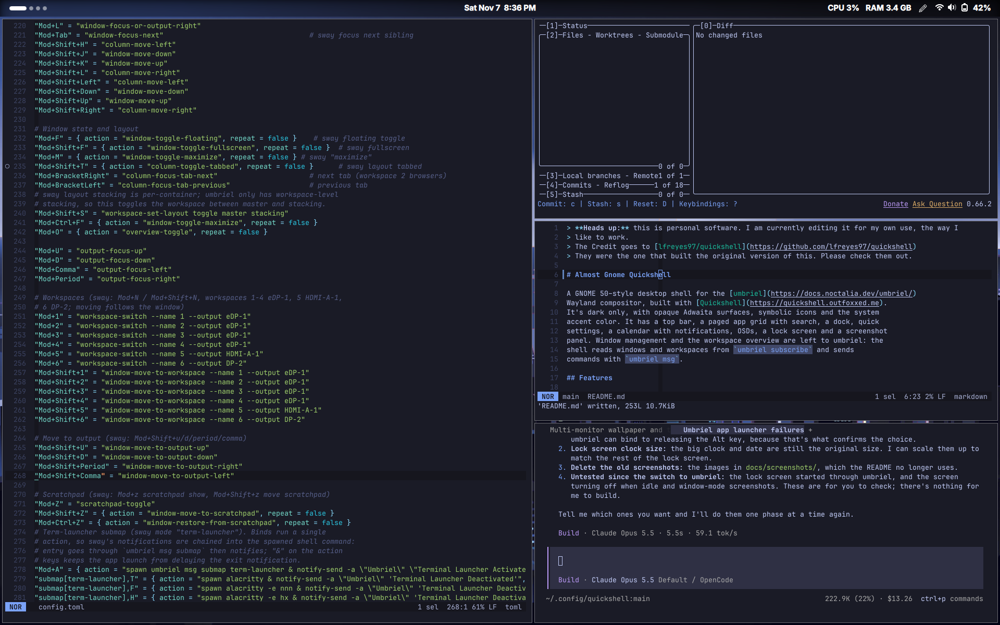

> **Heads up:** this is personal software. I am currently editing it for my own use, the way I
> like to work.
> The Credit goes to [lfreyes97/quickshell](https://github.com/lfreyes97/quickshell)
> They were the one that built the original version of this. Please check them out.

# QuickShell Config

A desktop shell for **Sway** that looks as close to vanilla **GNOME 50** as
possible, built with [Quickshell](https://quickshell.outfoxxed.me). It's dark
only, uses opaque Adwaita surfaces, symbolic icons and the system accent color,
and has the parts GNOME users expect: an overview with app search, quick
settings, OSDs, notifications and a screenshot UI. It also has a dock, which
GNOME doesn't.

> The screenshots below are from the original Hyprland version and are out of
> date (light/translucent styling, Spanish UI).



## Features

### Top bar

The GNOME 50 layout:
- **Left:** the workspace indicator pill (opens the overview).
- **Center:** the clock (opens the calendar and notifications).
- **Right:** the system tray, then the status icons (open quick settings).

The bar is solid black.

### Overview and app search

A mosaic of every workspace over the blurred wallpaper, with each window drawn
at its real position. Click a window to focus it, click a card to switch
workspace, or drag a window onto another card (or onto **New workspace**) to
move it. Start typing to search applications; <kbd>Enter</kbd> launches the
selected one.


### Hot corners

Two hot corners, GNOME style: keep the pointer in the corner for ~180 ms and
the action fires (passing by does nothing). The top‑left corner opens the
overview; the bottom‑left one opens the app grid (every installed application,
alphabetical and scrollable — keep typing to filter).

### Quick settings

Wi‑Fi, Bluetooth, Do Not Disturb, Caffeine (idle inhibitor) and Night Light
toggles; volume and brightness sliders with an audio output picker; power mode
(power saver / balanced / performance); battery, screenshot, settings, lock and
power menu. Controls whose backing tool is missing are shown disabled, with a
hint, instead of hidden.


### Calendar, notifications and media

Clicking the clock opens the calendar with the notification history and an
MPRIS media card. The shell is its own notification server, with toasts at the
top of the screen.


### Dock

Pinned apps first, then running apps that aren't pinned, plus a **Show Apps**
button that opens the app grid. Dots show open windows. Click to launch or
focus (it cycles through windows when an app has several), middle‑click for a
new window, right‑click for a menu (window list, new window, pin/unpin, quit).
It auto‑hides — reveal it at the bottom edge — and stays visible on empty
workspaces.

### Settings

A GNOME Settings-style window, opened from the gear button in Quick Settings
or with `qs ipc call settings open`:

- **Date & Time:** 24-hour clock, show weekday, show seconds, and a timezone
  for the top bar clock and calendar (the system timezone is left alone).
- **Top Bar:** show battery percentage.
- **Appearance:** accent color (written to GNOME's `accent-color` setting).
- **Background:** wallpaper folder and the wallpaper picker.
- **Dock:** auto-hide and icon size.
- **Night Light:** schedule and color temperature.

Changes apply immediately and are saved to `settings.json` (see State). You
can also edit that file by hand; the shell picks up the changes live.

### Lock screen

GNOME-style: blurred wallpaper with a big clock; click or start typing to get
your avatar, name and password field. It runs as its own Quickshell instance
(`lock.qml`), so a shell crash or config reload can't break it, and it uses
Sway's secure session lock: if it ever crashes, the screen stays locked rather
than unlocking. Lock from the button in Quick Settings, `qs ipc call lock lock`,
or start it directly (best for swayidle, since it doesn't need the shell):

```
qs -d -p ~/.config/quickshell/lock.qml
```

**If you ever get stuck** on a locked, blank screen, switch to another TTY
(<kbd>Ctrl</kbd>+<kbd>Alt</kbd>+<kbd>F2</kbd>), log in, and run
`pkill -f lock.qml`, then `qs -d -p ~/.config/quickshell/lock.qml` to get a
fresh lock screen to unlock (`swaymsg` needs `SWAYSOCK` set to your session's
socket in that TTY).

### Wallpaper

The shell draws the wallpaper itself and crossfades to a new one, like GNOME.
Pick one in **Settings → Background** (large preview, a scrollable grid from
the wallpaper folder, and shuffle), or jump there with
`qs ipc call wallpaper toggle`.


### Screenshot panel

GNOME‑style capture panel: selection, screen or window mode, delay and whether
to show the pointer. Captures are saved to
`$XDG_PICTURES_DIR/Screenshots/Screenshot From <date>.png`, copied to the
clipboard and announced with a notification.


### Also included

- **Volume and brightness OSD** above the dock.
- **Alt+Tab** window switcher (most recently used first).

## Requirements

- [Quickshell](https://quickshell.outfoxxed.me) **0.3.0 or newer** (checked against 0.3.2, the latest).
  Install it from your distribution's packages.
- **Sway**, plus `swaymsg` and `gtk-launch` (from GTK 3) to launch apps
- PipeWire with `wpctl`, [`light`](https://github.com/haikarainen/light) for brightness, `gsettings` + `gsettings-desktop-schemas`
- `grim`, `slurp`, `wl-clipboard`, `jq` and `notify-send` for screenshots
- Optional: `wlsunset` (night light), `power-profiles-daemon` (power mode),
  UPower (battery), BlueZ (Bluetooth), NetworkManager (Wi‑Fi)
- Fonts and icons: Adwaita Sans and the Adwaita icon theme (as in GNOME)

## Install

Symlink or copy the repo to `~/.config/quickshell`, and start it from your Sway
config:

```bash
ln -s /path/to/this/repo ~/.config/quickshell
```

```
exec qs
```

To develop with live reload, run it straight from the clone:
`qs -p /path/to/this/repo`.

### Things to watch out for

- **Remove swaybar and swaybg.** Delete or comment out the `bar { … }` block
  and any `output * bg …` line in your Sway config: the shell draws both the
  bar and the wallpaper.
- **Only one notification daemon.** If mako, dunst or swaync is installed and
  D‑Bus‑activatable, it can take `org.freedesktop.Notifications` before the
  shell does; toasts and history then stay empty, and the log shows
  `Could not register notification server`.
- **gsettings schemas under systemd.** When the shell runs as a systemd user
  service, `XDG_DATA_DIRS` may not include the GNOME schemas, and gsettings
  fails with `No schemas installed`: the accent color stops following the
  system. Set `GSETTINGS_SCHEMA_DIR` for the service.
- **Night light** follows the schedule in Settings (default 20:00 to 06:00).

## Keybindings (IPC)

Every command the shell accepts (also listed live by `qs ipc show`):

| Command | Action |
|---|---|
| `qs ipc call overview toggle` | Open/close the overview (from the app grid, switches to the workspace mosaic) |
| `qs ipc call overview open` | Open the overview |
| `qs ipc call overview close` | Close the overview |
| `qs ipc call overview apps` | Open the app grid |
| `qs ipc call screenshot toggle` | Open/close the screenshot panel |
| `qs ipc call lock lock` | Lock the screen (starts `lock.qml`) |
| `qs ipc call settings open` | Open Settings |
| `qs ipc call settings openPage <page>` | Open Settings on a page: `datetime`, `topbar`, `appearance`, `background`, `dock`, `nightlight` |
| `qs ipc call settings close` | Close Settings |
| `qs ipc call wallpaper toggle` | Open Settings on the Background page |
| `qs ipc call winswitch next` | Alt+Tab: show the switcher / select the next window |
| `qs ipc call winswitch prev` | Alt+Tab: select the previous window |
| `qs ipc call winswitch confirm` | Alt+Tab: focus the selected window and close (bind to Alt release) |
| `qs ipc call winswitch cancel` | Alt+Tab: close without switching |

The lock screen itself is a separate instance with no IPC; start it directly
with `qs -d -p ~/.config/quickshell/lock.qml`.

Example Sway config:

```
bindsym --release Super_L exec qs ipc call overview toggle
bindsym $mod+a exec qs ipc call overview apps
bindsym Print exec qs ipc call screenshot toggle
bindsym Mod1+Tab exec qs ipc call winswitch next
bindsym Mod1+Shift+Tab exec qs ipc call winswitch prev
bindsym --release Alt_L exec qs ipc call winswitch confirm
bindsym $mod+Escape exec qs -d -p ~/.config/quickshell/lock.qml

# Lock after 5 minutes idle and before suspend.
exec swayidle -w \
    timeout 300 'qs -d -p ~/.config/quickshell/lock.qml' \
    before-sleep 'qs -d -p ~/.config/quickshell/lock.qml'
```

## State

Preferences are stored in `$XDG_STATE_HOME/quickshell/` (usually
`~/.local/state/quickshell/`):

| File | Contents |
|---|---|
| `settings.json` | Everything set in the Settings window |
| `wallpaper` | Current wallpaper, re‑applied on startup |
| `dock-pinned.json` | Pinned apps (`.desktop` ids, in order) |

## Structure

```
shell.qml             Entry point: one Bar per screen
lock.qml              Lock screen, run as a separate instance (components/LockSurface.qml)
qmldir                Module definition (singletons)
Theme.qml             Colors, fonts and layout tokens; follows the accent live
Settings.qml          User settings (settings.json) + Settings window state
Clock.qml             Current time in the timezone chosen in Settings
Sway.qml              Window list from `swaymsg -t get_tree`, live via IPC events
PopupManager.qml      Which popup is open; overview/screenshot/settings IPC
Notifications.qml     Notification server + history
Switcher.qml          Alt+Tab state and IPC
Wallpaper.qml         Current wallpaper, saved across restarts
Osd.qml               Volume/brightness OSD state
DockPins.qml          Pinned dock apps
Caffeine.qml          Idle inhibitor state
AppLauncher.qml       Launches apps through Sway's exec
components/
  Bar.qml             Top bar; hosts the background, every popup, dock and OSD
  Background.qml      Desktop wallpaper with a GNOME-style crossfade
  Workspaces.qml      GNOME 50 workspace indicator pill
  HotCorner.qml       Hover‑with‑delay hot corners (overview / app grid)
  OverviewPopup.qml   Workspace overview + app search + app grid
  QuickSettingsPanel.qml
  CalendarPopup.qml   Calendar, notifications, MediaPlayer
  Dock.qml            Dock (DockItem, DockMenu)
  SettingsWindow.qml  Settings window (SettingsRow, TextField)
  WallpaperPicker.qml Wallpaper picker, shown in Settings → Background
  ScreenshotPopup.qml Screenshot panel
  OsdPopup.qml        Volume/brightness pill
  …                   Shared controls: PopupCard, QuickToggle, SliderRow,
                      SegmentedControl, ChipButton, TileButton, ActionRow…
```

## Customization

Most things are in the Settings window. For the rest, `Theme.qml` holds every
visual token (`barHeight`, `radius`, `iconSize`, `fontFamily`, colors).

## Design

New pieces follow [`DESIGN.md`](DESIGN.md): tokens, components, states,
motion, icons and copy guidelines. The reference is GNOME Shell 50 on a
1366×768 screen.
